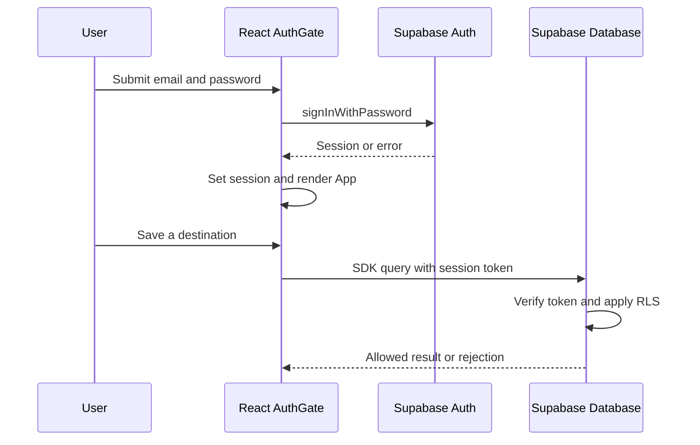

# YatriFlow authentication: code and documentation

This walkthrough covers [oghorpade060-eng/yatrifliow](https://github.com/oghorpade060-eng/yatrifliow), the tourism project featured in this portfolio. It is a fork of [omlaware07-code/yatrifliow](https://github.com/omlaware07-code/yatrifliow). Source files were reviewed on 6 November 2026. The live Supabase project and its deployed policies were not inspected.

## Components

| Component | What the code does |
| --- | --- |
| [`src/AuthGate.tsx`](https://github.com/oghorpade060-eng/yatrifliow/blob/main/src/AuthGate.tsx) | Displays sign-in/sign-up forms, restores sessions, subscribes to auth changes and handles logout |
| [`src/supabase.ts`](https://github.com/oghorpade060-eng/yatrifliow/blob/main/src/supabase.ts) | Creates one client using Vite environment variables and enables persistence, refresh and URL session detection |
| [`src/App.tsx`](https://github.com/oghorpade060-eng/yatrifliow/blob/main/src/App.tsx) | Receives the authenticated `userId` from `AuthGate` |
| [`src/useSavedPlaces.ts`](https://github.com/oghorpade060-eng/yatrifliow/blob/main/src/useSavedPlaces.ts) | Reads and changes saved places with user-ID filters |
| [Supabase Auth](https://supabase.com/docs/reference/javascript/auth) | Managed identity/session service called by the SDK |
| Supabase database policies | Must enforce authorization independently of the browser; deployed policies were not available for verification |

## Request flow



The final database checks are the required server-side boundary, not a guarantee inferred from the UI. The checked-in tree does not contain the SQL migration files named by the README, so actual RLS coverage cannot be confirmed from this repository.

### Starting the application

`AuthGate` registers `onAuthStateChange`, then calls `getSession()` to restore a stored session. It shows a loading state while checking. A session renders `<App key={session.user.id} userId={session.user.id} />`; otherwise the form remains visible. The subscription is removed when the component unmounts.

`getSession()` restores client session state; it is not by itself a server-side authorization check. [Supabase's reference](https://supabase.com/docs/reference/javascript/auth-getsession) explains that it reads the attached storage.

### Signing in or creating an account

The form reads email and password from `FormData`. It trims the email and checks matching passwords during sign-up. Sign-up inputs impose an eight-character browser minimum; the managed service's server-side password policy is a separate configuration.

```typescript
// Sign in
const { data, error } = await supabase.auth.signInWithPassword({
  email,
  password,
})

// Sign up
const { data, error } = await supabase.auth.signUp({
  email,
  password,
  options: { emailRedirectTo: `${window.location.origin}/` },
})
```

If sign-up returns a session, the app signs the user in. If not, it displays instructions to check the confirmation email. The exact behavior depends on the Supabase project's email settings. Allowed redirect URLs must be configured there; those settings are not present in the repo.

### Authenticated requests

The SDK receives the session and attaches its access token to authenticated Supabase requests. For example, `useSavedPlaces` selects `destination_id` and filters rows by `user_id`. An upsert supplies the user's ID and destination ID.

Those client filters help request the intended rows. They do not stop a modified client from submitting a different ID. Row Level Security policies must require the caller's authenticated identity to match the owner for reads and writes.

## Credentials and tokens

| Item | Handling visible in code or documented SDK behavior |
| --- | --- |
| Email and password | Read from the form and passed to Supabase Auth; the success path resets the form. The component does not explicitly write passwords to storage or logs. |
| `VITE_SUPABASE_URL` | Public service endpoint read at build time; missing configuration throws an error. Use an HTTPS Supabase endpoint. |
| `VITE_SUPABASE_PUBLISHABLE_KEY` | Public browser client key; it identifies the project but is not a user's access token or an admin credential. |
| Access token | Session credential used by the SDK for authenticated requests. Expiry is managed by Supabase, not hard-coded here. |
| Refresh token | Managed by the SDK; `autoRefreshToken: true` enables refreshing the session. |
| Session storage | `persistSession: true`; with the default browser storage, Supabase uses local storage. No custom storage is configured. |
| Redirect session | `detectSessionInUrl: true` lets the SDK process auth session information arriving through redirects. |
| Server/service-role secret | None is configured in the reviewed client code. A secret or service-role key must never be placed in a `VITE_` variable. |

Vite exposes its prefixed client environment variables in the browser build. Moving a client value into `.env.local` does not make it secret after bundling. The publishable key is expected to be public; authorization must be enforced on the server.

Default persistence means script running in the same origin can potentially access session storage. Avoid untrusted script execution and unsafe HTML injection. This is a browser-storage property, not evidence that an exploit is present here.

SDK references: [client options](https://supabase.com/docs/reference/javascript/initializing), [authentication storage](https://supabase.com/docs/reference/javascript/auth).

## Logout

```typescript
await supabase.auth.signOut({ scope: 'local' })
setSession(null)
setMode('signin')
```

The local scope signs out the current session rather than all devices. The SDK clears the locally stored session. Already issued access JWTs may remain valid until expiry; logout must not be described as instant revocation of every issued access token. See [Supabase signOut](https://supabase.com/docs/reference/javascript/auth-signout).

## Gaps to address before claiming production readiness

- The README names `yatriflow_phase0.sql` and `yatriflow_phase1.sql`, but they are absent from the checked-in tree reviewed here. Add versioned migrations and tests for ownership/RLS rules.
- The README's environment setup omits the variable examples required by `src/supabase.ts`.
- The deployed password policy, email confirmation, redirect allowlist and authorization policies have not been verified.
- The reviewed form does not implement a password-reset flow or MFA.
- Test that user A cannot read or mutate user B's saved places, trips or stays through direct API calls.

**Teaching distinction:** Authentication asks “Who are you?” Authorization asks “Which data may you access?” Hiding the application until login helps the interface; server-side authorization protects the data.

