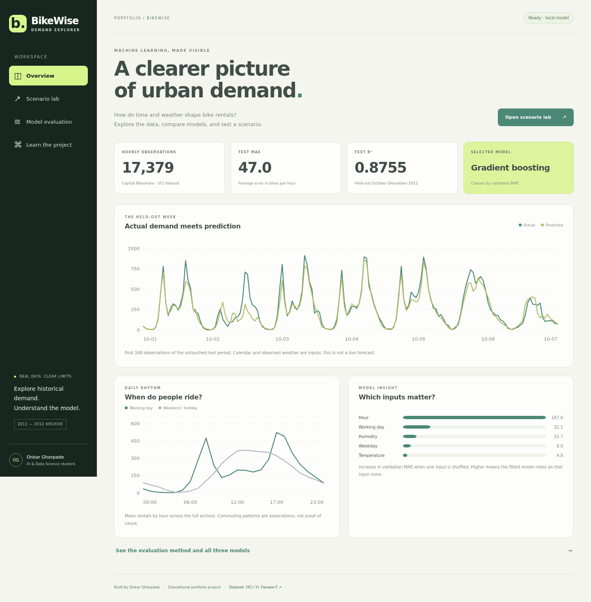

# BikeWise

**A reproducible AI & Data Science project by Onkar Ghorpade.**

Estimate hourly bike rentals from time and weather, compare models fairly, and explain the result in a local interactive dashboard.



## What is included

- A pinned, checksum-verified download of the UCI Bike Sharing dataset.
- Data checks, categorical encoding and numerical scaling inside scikit-learn pipelines.
- Mean baseline, Ridge regression and histogram gradient boosting.
- A chronological evaluation that keeps future observations out of training.
- A dashboard with actual-versus-predicted demand, hourly patterns, model comparisons, permutation importance and a scenario form.
- A Flask JSON API with bounded inputs and clear error responses.
- Automated behavior tests and a GitHub Actions workflow.
- [A model card](MODEL_CARD.md), [data attribution](data/README.md) and [English + Marathi learning notes](../../docs/LEARNING_GUIDE.md).

## Run on Windows PowerShell

Install Python 3.12 and Git, then run:

```powershell
git clone https://github.com/oghorpade060-eng/onkar-ghorpade.git
cd onkar-ghorpade\projects\bikewise
py -3.12 -m venv .venv
.\.venv\Scripts\python.exe -m pip install -r requirements.txt
.\.venv\Scripts\python.exe download_data.py
.\.venv\Scripts\python.exe train.py
.\.venv\Scripts\python.exe app.py
```

Open **http://127.0.0.1:5000**. These commands call the virtual environment directly, so PowerShell script activation is unnecessary.

## Run on macOS / Linux

```bash
git clone https://github.com/oghorpade060-eng/onkar-ghorpade.git
cd onkar-ghorpade/projects/bikewise
python3 -m venv .venv
.venv/bin/python -m pip install -r requirements.txt
.venv/bin/python download_data.py
.venv/bin/python train.py
.venv/bin/python app.py
```

Python 3.12 is the CI target. An internet connection is required for the initial dependencies and dataset download. After those steps, training and the dashboard work locally without external APIs. Stop the server with **Ctrl+C**.

## Measured evaluation

The CSV contains **17,379 rows**. Counts below are computed from the file, rather than copied from the dataset landing page.

| Split | Dates | Rows | Purpose |
| --- | --- | ---: | --- |
| Train | 2011-01-01 → 2012-06-30 | 13,003 | Fit candidates and their preprocessing |
| Validation | 2012-07-01 → 2012-09-30 | 2,208 | Select the model using MAE |
| Test | 2012-10-01 → 2012-12-31 | 2,168 | Evaluate after selection |

After selection, each candidate is refitted on train + validation. The chosen winner is unchanged when test results are computed.

| Model | Validation MAE | Test MAE | Test RMSE | Test R² |
| --- | ---: | ---: | ---: | ---: |
| Mean baseline | 197.829 | 156.868 | 204.428 | -0.0284 |
| Ridge regression | 111.930 | 89.511 | 121.782 | 0.6350 |
| **Gradient boosting** | **50.238** | **46.994** | **71.129** | **0.8755** |

MAE and RMSE are measured in **bikes per hour**. R² is **not percentage accuracy**. Run `train.py` to regenerate the [machine-readable results](reports/metrics.json). Small numerical differences may occur across platforms or library versions.

## How the application works

The browser sends one scenario to `POST /api/predict`. Flask validates the request and gets the date's calendar attributes from the original archive. The trained preprocessing pipeline transforms the inputs, then the selected regressor returns a nonnegative rental estimate. A second response field provides all 24 hours with the same weather inputs.

| Component | Responsibility |
| --- | --- |
| `download_data.py` | Download and verify the dataset |
| `model.py` | Feature contract, transformations, candidates and scenario validation |
| `train.py` | Chronological evaluation, metrics, importance and model export |
| `app.py` | Local Flask application and inference routes |
| `templates/`, `static/` | Responsive dashboard and scenario controls |
| `reports/` | Reproducible metrics and dashboard data |
| `tests/` | Data separation, real inference, invalid input and error-state checks |

## API

| Route | Behavior |
| --- | --- |
| `GET /api/health` | Reports whether a local model is loaded |
| `GET /api/report` | Returns the evaluation and chart data |
| `POST /api/predict` | Validates inputs and returns an estimate and 24-hour curve |

Example request:

```json
{"date":"2012-10-15","hour":8,"weather":1,"temperature":20,"humidity":55,"wind":10}
```

Dates must exist in the 2011–2012 archive. Temperature is °C, humidity is %, and wind speed is km/h. Weather is 1 (clear), 2 (mist/clouds), or 3 (light rain/snow). The extreme-weather category is excluded from the scenario form because it has very few observations.

## Test

```powershell
.\.venv\Scripts\python.exe -m pytest -q
```

On macOS/Linux use `.venv/bin/python -m pytest -q`. Run the download and training commands first; integration tests use the real dataset and local model.

## Authentication and deployment

BikeWise has **no login, passwords, tokens or paid API keys**. It is a local educational application using public data. The server binds to `127.0.0.1`, debug mode is off, and no model-upload endpoint exists. Load only the artifact generated by your own `train.py`: joblib/pickle files can execute code when loaded.

The built-in Flask server is for local development. Public deployment would need a production WSGI server, resource limits, monitoring and an access policy appropriate to the intended audience. This repository does not claim production deployment.

## Limits and next improvements

This is a historical demand-estimation benchmark, not a live forecasting service. Recorded weather is available during evaluation; real forecasting would require weather forecasts available at prediction time. The model has no calibrated prediction intervals and has not been validated on present-day data or another city. See the [model card](MODEL_CARD.md).

Next experiments: rolling-origin evaluation, leakage-safe lagged features, a seasonal baseline, forecast-weather inputs, calibrated uncertainty and validation on a newer dataset.

## Credits

Dataset: H. Fanaee-T, *Bike Sharing* (2013), UCI Machine Learning Repository, [DOI: 10.24432/C5W894](https://doi.org/10.24432/C5W894), **CC BY 4.0**. Source code is licensed under the repository's MIT license; that license does not replace the dataset's license.
