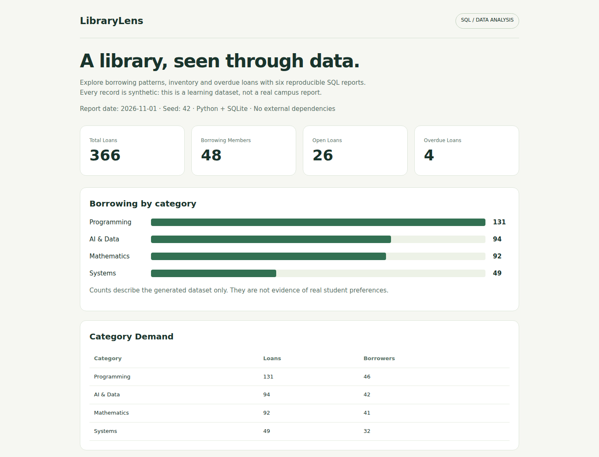
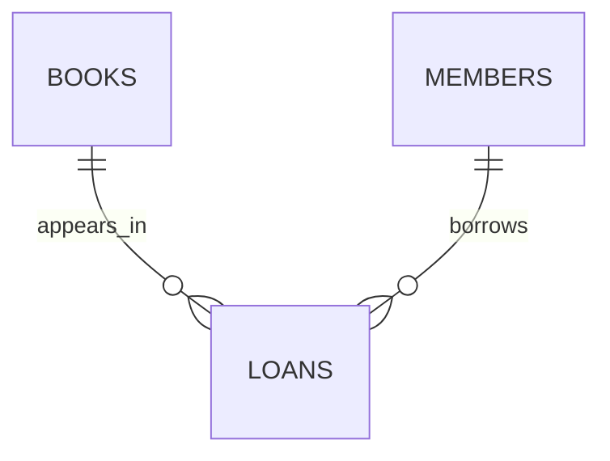

# LibraryLens

**A SQL analytics project with a reproducible, synthetic campus-library dataset.**

Generate six reports about borrowing activity, overdue loans and inventory. Learn joins, aggregations, common table expressions and window functions while checking edge cases that change the answer.



## Run in one command

From this folder, with Python 3.12:

```bash
python report.py
```

On Windows you can use `py -3.12 report.py`; on macOS/Linux use `python3 report.py`. No packages, API keys, database server or internet connection are required. Open `reports/dashboard.html` in a browser. It is a standalone offline report, not a hosted website.

To inspect an earlier date:

```bash
python report.py --as-of 2026-07-15 --output reports/july
python -m unittest discover -s tests -v
```

Dates must be between 2026-05-01 and 2026-11-01. Use a separate output directory when keeping multiple reports. Reusing an output directory replaces those report files, including empty CSV results.

## What is in the data?

The generator uses seed 42, **12 fictional book titles**, **48 synthetic member IDs**, and **366 generated loans**. It contains no actual student names, emails or borrowing records. At the default report date of 2026-11-01, there are **26 open loans** and **4 overdue loans**. These values describe generated data, not a real institution.



Books store category and total copies; members store a synthetic ID and department; loans store borrow, due and return dates. Foreign keys connect the tables. The generator respects available copies when creating loans.

## Questions answered

| Query | Question | SQL concept |
| --- | --- | --- |
| [overview.sql](sql/overview.sql) | How many loans, borrowers, open loans and overdue loans exist? | Aggregation and conditional counts |
| [category_demand.sql](sql/category_demand.sql) | Which categories were borrowed most? | LEFT JOIN, GROUP BY, distinct counts |
| [monthly_activity.sql](sql/monthly_activity.sql) | How did activity change each month, including empty months? | Recursive CTE, LAG |
| [category_ranking.sql](sql/category_ranking.sql) | Which titles rank highest within each category? | DENSE_RANK, PARTITION BY |
| [overdue_loans.sql](sql/overdue_loans.sql) | Which loans were overdue on a specified date? | Joins, NULL, date arithmetic |
| [inventory.sql](sql/inventory.sql) | How many copies were available on that date? | Conditional join, counting |

The final month may be incomplete. For example, the default report contains only November 1, while the generated borrowing history ends October 31. A fall in that month's count is not evidence of falling demand. The report displays raw counts, not a seasonally adjusted trend.

## Details that make the result trustworthy

- A book due today is not overdue: the condition is `due_at < :as_of`.
- A book returned after a historical report date was still open on that date.
- Future borrowing events are excluded.
- LEFT JOIN keeps unused books and categories visible with zero counts.
- A calendar CTE retains zero-activity months before `LAG` computes changes.
- Date values are bound SQL parameters, not string interpolation.
- Tests check date boundaries, relational constraints, joins, historical returns, reproducibility, inventory limits and CSV replacement.

Each run writes JSON, six CSVs and an HTML report. The in-memory SQLite database is recreated from the same seed. There is no login, network API or persistent production database. This is a separate analytics project; it does not read or change the existing Library Management Platform.

## Practice extensions

1. Add a department-level borrowing report. State whether you are counting loans or unique members.
2. Compare complete months only, then explain why the result differs from the raw monthly table.
3. Add average return delay, excluding loans still open. Explain that exclusion.
4. Add a test for two books tied in the same category ranking.

References: [SQLite window functions](https://www.sqlite.org/windowfunctions.html), [SQLite date functions](https://www.sqlite.org/lang_datefunc.html), [SQLZoo exercises](https://sqlzoo.net/wiki/SQL_Tutorial), and the [study plan](../../docs/STUDY_PLAN.md).
