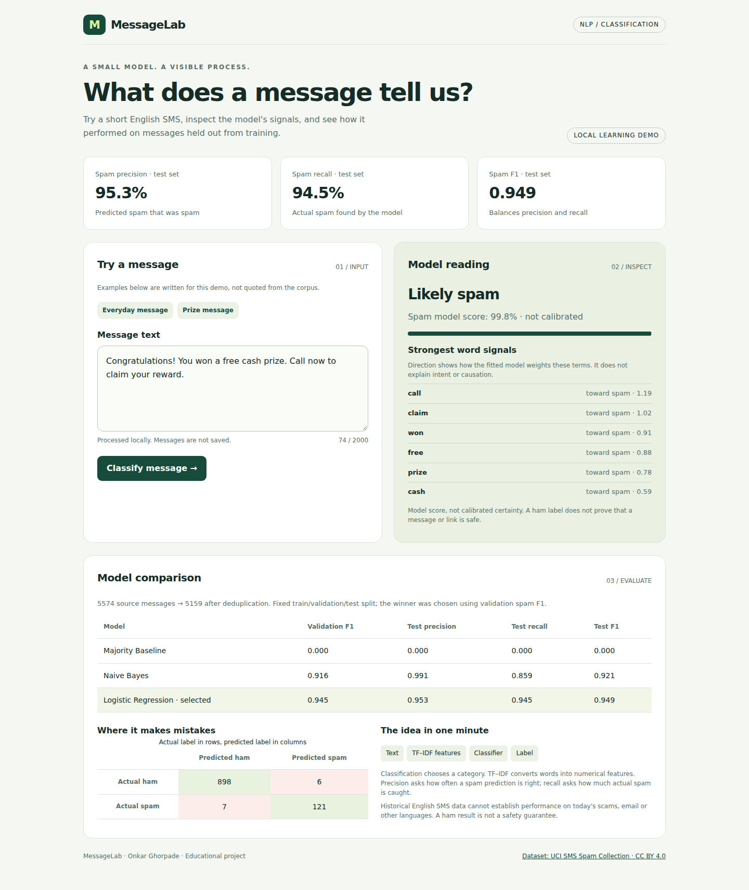

# MessageLab

**An SMS classification project for learning NLP, evaluation and local model serving.**

Type a short English message, inspect the model's prediction and word signals, and compare that prediction with measured test-set performance. No API key or GPU is needed.



## What is implemented

- A checksum-verified downloader for the public UCI SMS Spam Collection.
- Duplicate removal before splitting, with an explicit rule to exclude conflicting labels.
- A majority-class baseline, TF–IDF + Multinomial Naive Bayes, and TF–IDF + logistic regression.
- A fixed stratified train/validation/test split and selection by validation spam F1.
- A command-line predictor and a local Flask interface with word contributions and a confusion matrix.
- Request validation, a response for unknown vocabulary, behavior tests and GitHub Actions.

## Run it

From the repository root:

```powershell
cd projects/messagelab
py -3.12 -m venv .venv
.\.venv\Scripts\python.exe -m pip install -r requirements.txt
.\.venv\Scripts\python.exe download_data.py
.\.venv\Scripts\python.exe train.py
.\.venv\Scripts\python.exe app.py
```

Open **http://127.0.0.1:5001**. Stop with Ctrl+C.

On macOS/Linux, create the environment with `python3 -m venv .venv`, then use `.venv/bin/python` instead of `.\.venv\Scripts\python.exe` in each command. Python 3.12 is the CI target.

For command-line inference or tests, use your environment's Python:

```bash
python predict.py "Meet me at the library after class."
python -m pytest -q
```

Internet access is needed for initial dependency installation and the dataset download. Training and inference then run locally.

## Measured results

The downloaded file has **5,574** rows. Lowercasing and whitespace normalization identify **415** duplicate rows, leaving **5,159** distinct messages. There are **0** conflicting-label groups in this version. The cleaned data contains 4,517 ham and 642 spam messages.

| Partition | Messages | Spam messages |
| --- | ---: | ---: |
| Train | 3,095 | 385 |
| Validation | 1,032 | 129 |
| Test | 1,032 | 128 |

Candidate configurations are fixed in `model.py`. TF–IDF is fitted on the training partition during selection. After choosing the winner, each candidate is refitted on train + validation for the final comparison. The test set does not select the model or threshold.

| Model | Validation spam F1 | Test precision | Test recall | Test spam F1 |
| --- | ---: | ---: | ---: | ---: |
| Majority baseline | 0.0000 | 0.0000 | 0.0000 | 0.0000 |
| Naive Bayes | 0.9160 | 0.9910 | 0.8594 | 0.9205 |
| **Logistic regression** | **0.9449** | **0.9528** | **0.9453** | **0.9490** |

The selected model's test accuracy is 98.74%, but accuracy alone hides class imbalance: the baseline reaches 87.60% while catching no spam. The test confusion matrix is:

| Actual / predicted | Ham | Spam |
| --- | ---: | ---: |
| Ham | 898 | 6 |
| Spam | 7 | 121 |

That means **6 ordinary messages were flagged** and **7 spam messages were missed**. These are measurements from one historical holdout, not a guarantee for new messages. [Full reproducible metrics](reports/metrics.json).

## Components and request flow

| File | Responsibility |
| --- | --- |
| `download_data.py` | Verify and download the original corpus |
| `model.py` | Deduplicate, split, construct candidates and explain predictions |
| `train.py` | Compare models, select on validation F1, export metrics and the final model |
| `predict.py` | Classify one message from a terminal |
| `app.py` | Serve the page and validate prediction requests |
| `templates/index.html` | Local interface with measured metrics and word signals |

The form sends `POST /api/predict` with `{"text": "your message"}`. Flask checks the JSON shape and 2,000-character limit. The fitted TF–IDF transformer converts text to a sparse vector. The classifier returns a label and an uncalibrated spam score. For the selected logistic model, displayed word contributions are `TF–IDF value × coefficient`; the six largest absolute contributions are shown. The full decision also includes the intercept and the remaining features.

No known vocabulary produces `unknown`, not a reassuring ham result. No submitted text is saved by the application. There is no authentication, message upload service or external model API. The model file must be generated locally: never load an untrusted joblib/pickle file.

## Limits and next experiments

- This is an educational classifier, not an anti-fraud or link-safety product.
- The corpus is old and predominantly English. Its results do not establish performance on current scams, email, Marathi or Hindi.
- Exact normalized duplicates are removed; near duplicates, templates and sender-level overlap may remain. A harder template/group holdout would be a useful experiment.
- Scores are not calibrated probabilities of truth. Word contributions are model signals, not causal explanations.
- One random holdout does not measure uncertainty across alternative splits. Try repeated development-only cross-validation before a new final evaluation.
- A future experiment could compare character n-grams, inspect errors locally, and calibrate scores on separate validation data. Do not repeatedly choose changes from test performance.

## Dataset and references

Almeida, T. & Hidalgo, J. (2011), **SMS Spam Collection**, UCI Machine Learning Repository, [DOI: 10.24432/C5CC84](https://doi.org/10.24432/C5CC84), **CC BY 4.0**. The repository stores the downloader and aggregate reports, not the raw messages. The code's MIT license does not replace the data license.

- [scikit-learn text classification example](https://scikit-learn.org/stable/auto_examples/text/plot_document_classification_20newsgroups.html)
- [scikit-learn feature extraction](https://scikit-learn.org/stable/modules/feature_extraction.html)
- [scikit-learn leakage and preprocessing guidance](https://scikit-learn.org/stable/common_pitfalls.html)
- [Project lesson and viva](../../docs/MESSAGELAB_LESSON.md)
